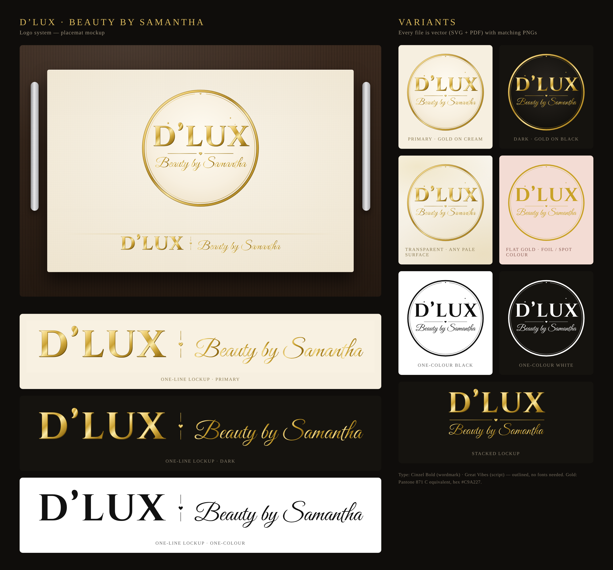

# D’LUX — Beauty by Samantha · logo system

Print-ready vector logo built from the original AI concept: the gold circular badge,
the **D’LUX** serif wordmark, the hairline-and-heart divider and the *Beauty by Samantha*
script, redrawn as clean geometry so it scales to anything from a business card to a
shop-front sign.



## Which file do I send to the printer?

| Job | Use this | Why |
| --- | --- | --- |
| Paper placemats, menus, flyers, posters (full-colour print) | `pdf/dlux-logo-primary.pdf` or `pdf/dlux-logo-dark.pdf` | Vector PDF, prints razor-sharp at any size; the metallic gold is a CMYK gradient |
| Anything on a coloured or textured surface | `pdf/dlux-logo-transparent.pdf` / `png/dlux-logo-transparent-4096px.png` | No disc behind it, gold artwork only |
| Gold foil, hot-stamp, embossing, vinyl, screen print, engraving | `svg/dlux-logo-gold-flat.svg` (or `-black` / `-white`) | One flat colour, no gradients: this is what foil and spot-colour presses need |
| Rubber stamps, embroidery, laser etch | `svg/dlux-logo-black.svg` | Solid single colour, no hairline detail that would fill in |
| Instagram / Facebook profile, website | `png/dlux-logo-primary-2048px.png` | Already square, crops cleanly into a circle |
| Website header, email signature, long placemat edge | `png/dlux-horizontal-*.png` / `svg/dlux-horizontal-*.svg` | One-line lockup |
| Price lists, gift vouchers, rectangular labels | `*/dlux-stacked-*` | Wordmark without the ring |

If a printer asks for "vector" or "EPS/AI", send the **PDF** — every modern print shop
opens it in Illustrator directly. If they ask for "outlined fonts", they already are:
the files contain no fonts at all.

## Colours

| | Hex | CMYK | Pantone |
| --- | --- | --- | --- |
| Flat gold (foil / spot) | `#C9A227` | 20 · 30 · 95 · 5 | 871 C (metallic) or 7555 C (non-metallic) |
| Deep gold (shadows) | `#8F6A14` | 35 · 50 · 100 · 25 | 125 C |
| Cream disc | `#F8F1E2` | 2 · 4 · 12 · 0 | 7499 C |
| Noir disc | `#15130F` | 70 · 65 · 70 · 85 | Black 6 C |

The metallic effect in the primary and dark files is a gradient between the golds
above; it prints well in CMYK and on a good home printer. For true metallic, use the
flat-gold file with Pantone 871 C ink or gold foil.

## Rules of thumb

- **Clear space:** keep at least the height of the heart ×3 (about 8 % of the badge
  width) free around the mark.
- **Minimum size:** 30 mm (1.2 in) wide for the round badge, 20 mm for the stacked
  lockup, 50 mm for the one-line lockup. Below that, use the flat single-colour files.
- **Backgrounds:** primary and transparent on pale surfaces; dark or white version on
  anything darker than mid-grey. Never place the gold gradient on a busy photo.
- Don't stretch, re-colour, add effects, or re-set the wording in a different font.

## Typefaces

- Wordmark: **Cinzel Bold** (Natanael Gama, SIL Open Font License)
- Script: **Great Vibes** (TypeSETit, SIL Open Font License)

Both are free for commercial use. The TTFs are in `build/fonts/` if you ever need to set
extra wording (e.g. a phone number) in the same style.

## Rebuilding / editing

The artwork is generated from `build/build_logo.py`, so any wording or spacing change
is a one-line edit followed by a rebuild:

```bash
cd brand/dlux-beauty/build
pip install fonttools uharfbuzz skia-pathops
python3 build_logo.py fonts ../svg               # regenerates every SVG
node render.js ../svg ../png --png-sizes 2048,4096 --pdf   # PNGs + PDFs (needs playwright)
```

Folder layout:

```
svg/   editable vector masters (open in Illustrator, Inkscape, Canva, Figma…)
pdf/   print masters, vector
png/   ready-to-use raster: 2048 & 4096 px round badge, 3000 px stacked, 4800 px one-line
build/ generator, renderer and the two fonts
```
